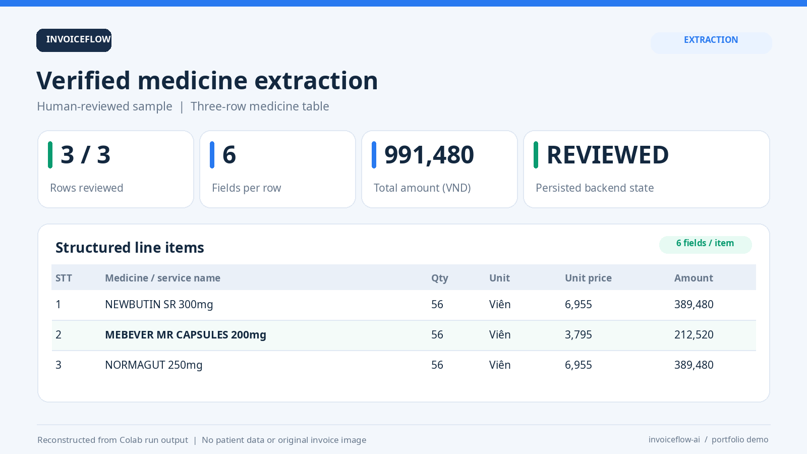
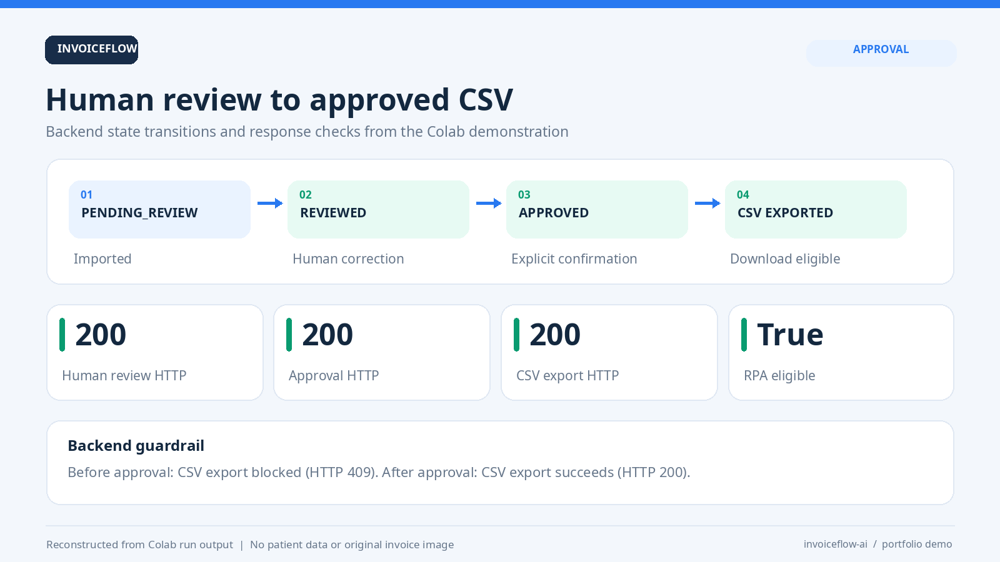
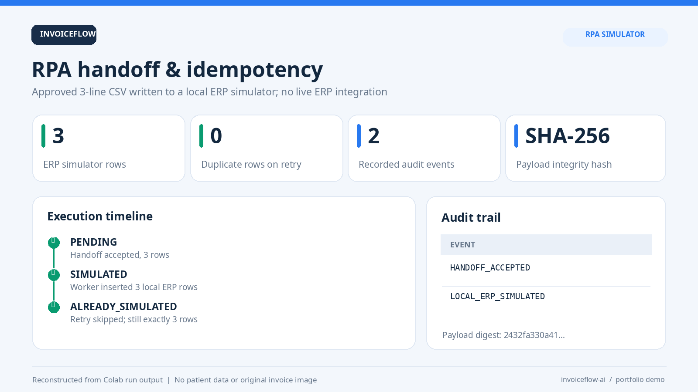
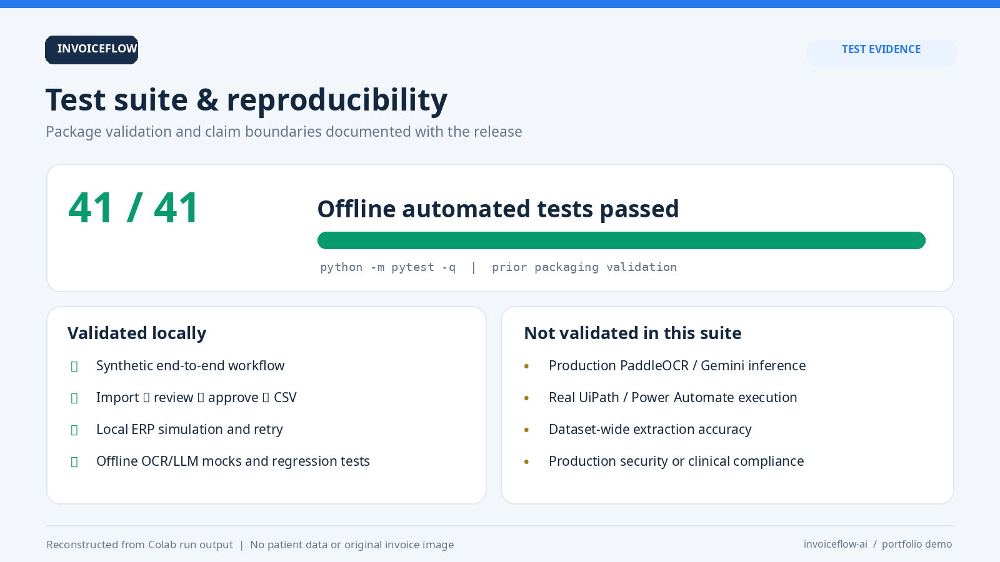
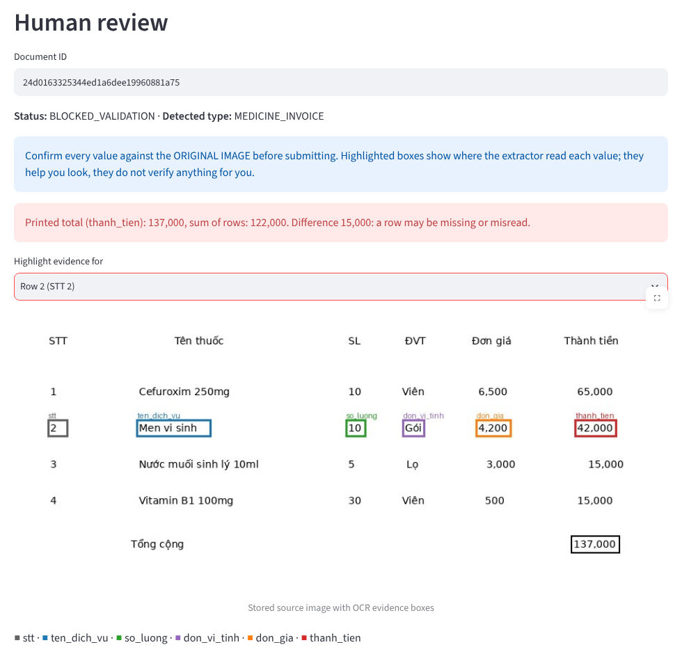
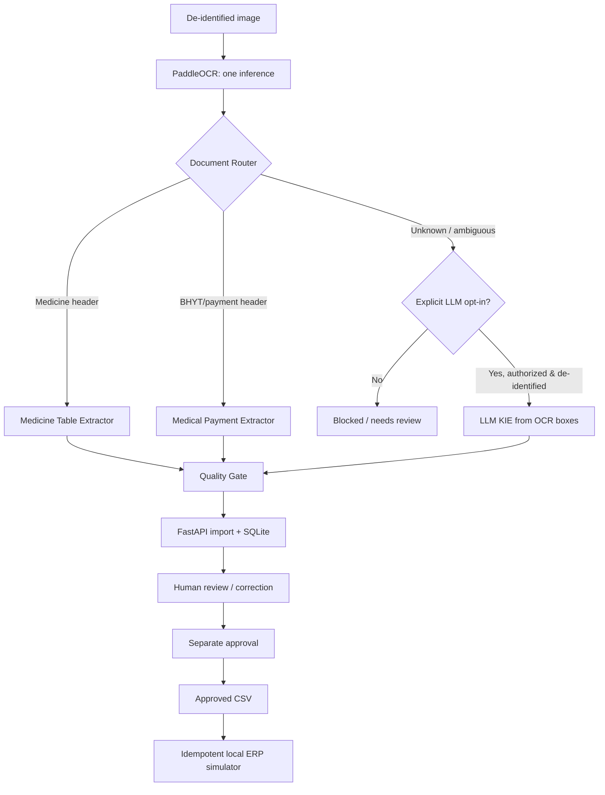
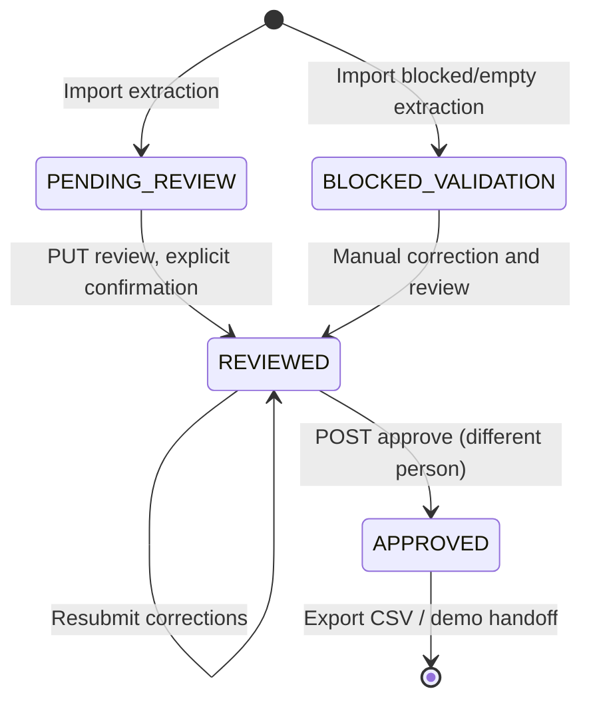

# InvoiceFlow AI

**Vietnamese document intelligence · OCR-grounded KIE · Human-in-the-loop approval · RPA-ready handoff**

> **Status: portfolio / local-demo baseline, not production clinical software.** The extracted content is not a medical diagnosis. Do not process identifiable patient information without appropriate authority, de-identification, security controls, and compliance review. No real ERP or Power Automate/UiPath bot is included. A local SQLite *ERP simulator* demonstrates handoff safely.

InvoiceFlow AI takes an image of a Vietnamese medication invoice or healthcare payment receipt and produces **structured, reviewable data**. A conservative document router selects a layout-specific extractor. Unknown layouts can optionally use an LLM **only after explicit opt-in** and an appropriate privacy review. All extracted data must pass through manual review and explicit approval before CSV export. A local RPA worker proves **idempotent handoff**.

This repository consolidates the modules prototyped and tested in Google Colab into a reusable Python package, FastAPI backend, optional Streamlit interface, regression tests, CI workflow, and developer/agent documentation.

**Language:** Code and developer docs in English; Vietnamese data field names (`ten_dich_vu`, `so_luong`, etc.) are preserved to match the reference dataset.

## Results & demo evidence

**A quick visual walkthrough of the completed Colab prototype** — these PNG cards are **reconstructed from the observed run output**, **not screenshots of a live ERP or a dataset-wide benchmark**. They intentionally contain no patient images, names, API keys, or confidential source documents.

### 1. Medicine invoice KIE — human-verified result



The Colab example extracted three medicine lines. After the operator corrected the second medicine name against the source document, the final reviewed result was:

| STT | Medicine / service | Quantity | Unit | Unit price (VND) | Amount (VND) |
| --- | --- | ---: | --- | ---: | ---: |
| 1 | NEWBUTIN SR 300mg | 56 | Viên | 6,955 | 389,480 |
| 2 | MEBEVER MR CAPSULES 200mg | 56 | Viên | 3,795 | 212,520 |
| 3 | NORMAGUT 250mg | 56 | Viên | 6,955 | 389,480 |
| | **Total** | | | | **991,480** |

> **Evidence limitation:** These are values in one manually reviewed Colab example, not raw OCR accuracy claims. OCR initially returned `MEBEVER MR CAPSUL.ES 200mg`; human review fixed that text. Monetary arithmetic is verified; visual/source correctness requires the human review.

### 2. Human review → approval → approved CSV



The recorded flow reached `PENDING_REVIEW → REVIEWED → APPROVED`. Review, approval, and approved CSV export each returned **HTTP 200**. An attempted export **before** approval returned **HTTP 409** as intended. `ready_for_rpa` only became `true` after explicit approval.

### 3. RPA handoff → ERP simulator → no duplicate on retry



The approved 3-row CSV generated a `PENDING` handoff job. The local worker changed the state to `SIMULATED`, wrote three rows to a **local SQLite ERP simulator**, then returned `ALREADY_SIMULATED` on retry without inserting duplicates. The recorded audit events were `HANDOFF_ACCEPTED` and `LOCAL_ERP_SIMULATED`. **No live ERP, UiPath, or Power Automate integration is claimed.**

### 4. Automated test evidence and boundaries



The package baseline reported **41/41 passing offline automated tests** plus a standalone **synthetic** end-to-end demo. The test suite mocks OCR/LLM calls and does not measure document accuracy across the full dataset.

**Reproduce:** `python -m pytest -q` and `python scripts/demo_workflow.py`. To regenerate the four graphics from the documented example values, install Pillow (`python -m pip install pillow`) and run `python scripts/render_demo_results.py`.

### 5. Evidence viewer and document total check (synthetic document)



A real screenshot of the review UI on a **generated** document from the evaluation set (`eval/synthetic/med_04_dropped_row`). OCR missed row 3 entirely; every remaining row still balances on its own, but the printed total (137,000) does not match the sum of rows (122,000), so the document is blocked with `BLOCKED_TOTAL_MISMATCH`. Selecting a row draws the OCR boxes each value was read from on the stored source image.

### 6. Reproducible evaluation

`make eval` regenerates the synthetic set, replays its OCR through the current pipeline and scores it with the metrics in [Evaluation](docs/EVALUATION.md). The same commands score real, de-identified labelled data (`invoiceflow eval GT_DIR PRED_DIR`). Synthetic scores only exercise code paths; **no accuracy on real scans is claimed.**

Read [Results & limitations](docs/RESULTS.md) for evidence provenance, recorded outputs, and which claims are **not** validated.

## At a glance

| Capability | Implementation | Current scope |
| --- | --- | --- |
| OCR | PaddleOCR 3.x (optional install) | Vietnamese text boxes with coordinates/confidence |
| Document routing | Header-signature heuristics | `MEDICINE_INVOICE`, `MEDICAL_PAYMENT`, `UNKNOWN` |
| Medicine KIE | Geometry, STT anchors, monotone alignment | Six-field medication tables |
| Payment KIE | BHYT/cost/patient settlement columns | Baseline BHYT tables |
| LLM fallback | Optional Google Gemini adapter | **OCR text/box IDs only**, unknown layouts, explicit opt-in |
| Evidence validation | OCR box references + arithmetic rules | Invalid/missing data causes review/block |
| Human review | FastAPI + Pydantic + SQLite | Import → review → approve → CSV |
| RPA handoff | Approved CSV + SHA-256 + SQLite | Local ERP simulation; duplicate prevention |
| UI | Streamlit (optional) | Local operator review dashboard |
| Tests | pytest + deterministic fake OCR | Offline: no external API/model downloads |

## System architecture



**Important:** A model returning an apparently valid name or arithmetic result is **not** human verification. Inference sets `ready_for_rpa = false`. Only the backend's reviewed-and-approved state makes a CSV export eligible.

## Repository map

```text
invoiceflow-ai/
├── README.md                         # Start here
├── AGENTS.md                         # Repo instructions for coding AI agents
├── RULES.md                          # Invariants, privacy, safety and coding rules
├── agent-skill.md                    # Reusable engineering workflow/skill
├── assets/results/                   # Four illustrated demo result cards (PNG)
├── pyproject.toml                    # Installable package + optional extras
├── .env.example                      # Configuration without secrets
├── Dockerfile / compose.yaml         # Review-only local container
├── Makefile                          # Development commands
├── src/invoiceflow_ai/
│   ├── header_detection.py           # VI header aliases / multiline recovery
│   ├── ocr_adapter.py                # Lazy PaddleOCR 3.x adapter
│   ├── document_router.py            # OCR once, cached extractor invocation
│   ├── medicine_table_extractor.py   # Medicine KIE + quality gate
│   ├── medical_payment_extractor.py  # BHYT/payment KIE + quality gate
│   ├── llm_kie_fallback.py           # OCR-evidence-grounded LLM fallback
│   ├── gemini_adapter.py             # Optional opt-in API connector
│   ├── pipeline.py                   # Integration entry point
│   ├── backend_app.py                # SQLite, review/approve/export REST API
│   ├── api.py                        # ASGI composition / safe defaults
│   ├── rpa_handoff.py                # Approved CSV / local ERP simulator
│   └── cli.py                        # `invoiceflow` command
├── frontend/streamlit_app.py         # Optional local review UI
├── scripts/
│   ├── demo_workflow.py              # Full synthetic no-OCR walkthrough
│   ├── rpa_handoff_cli.py            # HTTP approved CSV → local ERP simulation
│   └── render_demo_results.py        # Regenerate README evidence PNGs (Pillow)
├── tests/                            # Offline tests + integration regression
├── examples/synthetic_extraction.json
├── docs/                              # Architecture, API, results, security, evaluation
└── .github/workflows/ci.yml          # Automated test workflow
```

## Quick start A — Fully offline synthetic demonstration (recommended first)

**Requirements:** Python 3.10–3.12 recommended, Git, terminal. Python 3.13 has also been used for offline tests in the source-generation environment; optional OCR dependencies may have platform-specific constraints.

### Windows PowerShell

```powershell
git clone https://github.com/YOUR_USERNAME/invoiceflow-ai.git
cd invoiceflow-ai
py -3.11 -m venv .venv
.\.venv\Scripts\Activate.ps1
python -m pip install --upgrade pip
python -m pip install -e ".[dev]"
python -m pytest
python scripts/demo_workflow.py
```

### macOS / Linux

```bash
git clone https://github.com/YOUR_USERNAME/invoiceflow-ai.git
cd invoiceflow-ai
python3 -m venv .venv
source .venv/bin/activate
python -m pip install -e '.[dev]'
python -m pytest
python scripts/demo_workflow.py
```

The synthetic demo creates temporary SQLite files, inserts two **invented items**, reviews and approves them via FastAPI TestClient, exports CSV, submits an RPA job, runs the **local** ERP simulator, then proves a second run does not duplicate entries. No internet, OCR model, Gemini API key, patient data or live ERP is involved once dependencies are installed.

## Quick start B — FastAPI server + local UI

Generate a new API key. **Do not commit `.env`.**

```bash
python -c "import secrets; print(secrets.token_urlsafe(32))"
```

Copy `.env.example` to `.env`, replace `INVOICEFLOW_API_KEY` with the generated secret, then load the variables into your terminal (the app itself does not auto-read `.env`):

```bash
# macOS / Linux (example; substitute your real secret from a secure source)
export INVOICEFLOW_API_KEY='your-long-random-key'
export INVOICEFLOW_DB_PATH='./data/invoiceflow.sqlite3'
invoiceflow serve
```

PowerShell:

```powershell
$env:INVOICEFLOW_API_KEY = "your-long-random-key"
$env:INVOICEFLOW_DB_PATH = ".\data\invoiceflow.sqlite3"
invoiceflow serve
```

Open **http://127.0.0.1:8000/docs** (interactive API documentation). `GET /health` is unauthenticated; all document endpoints require the `X-API-Key` header.

For the optional UI, use another terminal with the **same** environment key:

```bash
pip install -e '.[ui]'
streamlit run frontend/streamlit_app.py
```

The server defaults to **review-only mode**: `POST /api/v1/documents/upload` returns HTTP 503 until `INVOICEFLOW_ENABLE_OCR_UPLOAD=true` and OCR dependencies are available. You may still import a *synthetic* structured extraction using `POST /api/v1/documents/import`.

### Import synthetic JSON (example)

```bash
curl -X POST http://127.0.0.1:8000/api/v1/documents/import \
  -H "X-API-Key: $INVOICEFLOW_API_KEY" \
  -H "Content-Type: application/json" \
  -d '{"source":"synthetic","result":{"status":"EXTRACTED","document_type":"MEDICINE_INVOICE","qa_status":"PENDING_HUMAN_REVIEW","ready_for_rpa":false,"items":[{"stt":1,"ten_dich_vu":"DEMO Vitamin 100mg","so_luong":2,"don_vi_tinh":"Viên","don_gia":1500,"thanh_tien":3000}]}}'
```

The API responds with an `id` and `status: PENDING_REVIEW`. See [API reference](docs/API.md) for review/approve/export calls and restrictions.

## Quick start C — Real local OCR from a de-identified image

PaddleOCR has larger system/dependency requirements than the API. On CPU, inference can take seconds to tens of seconds. Model weights may download on the first run. Check the [official PaddleOCR 3.x documentation](https://github.com/PaddlePaddle/PaddleOCR/blob/main/docs/version3.x/pipeline_usage/OCR.en.md) for your OS, PaddlePaddle version, `lang` and model compatibility.

```bash
pip install -e '.[ocr]'
# Install the compatible PaddlePaddle runtime for your OS/CPU/GPU separately.
invoiceflow extract path/to/deidentified_sample.png --output data/extracted.json
```

The result JSON is written to `data/` (ignored by Git). For an OCR-enabled HTTP upload in a **local/private** environment:

```bash
export INVOICEFLOW_ENABLE_OCR_UPLOAD=true
invoiceflow serve
```

**OCR never runs inside the default CI tests.** Your Colab experiments used PaddleOCR 3.x with a Vietnamese model and `predict()` returning `rec_texts`, `rec_boxes` and `rec_scores`. This package preserves that response format; it does not bundle pretrained weights.

### Optional Gemini fallback for UNKNOWN layouts

Only use data whose disclosure to the external provider is permitted and which has been properly de-identified. OCR boxes can still contain patient information even when no image is sent.

```bash
pip install -e '.[ocr,gemini]'
export GEMINI_API_KEY='set-in-your-local-secret-manager'
invoiceflow extract path/to/verified_deidentified.png --external-llm --output data/fallback.json
```

The `--external-llm` flag is the **explicit opt-in**. Without it, UNKNOWN documents return `FALLBACK_NOT_AUTHORIZED`; the default HTTP upload endpoint **does not** call Gemini. Gemini model availability, quotas and billing depend on your account. A response is still subject to OCR evidence validation, manual review and approval.

## Human review and approval state machine



The backend validates *persisted* reviewed rows, integer quantities, nonnegative prices, unique STT and `so_luong × don_gia = thanh_tien`. For BHYT tables it also validates `chi_phi - bhyt_chi - so_giam = benh_nhan_thanh_toan`. Names and units that a spreadsheet could evaluate (`=`, `+`, `-`, `@`) and placeholder words (`REVIEW`, `APPROVE`, ...) are rejected at review, using the same rules as the RPA handoff (`validation.py`), so an approved document never fails handoff. It records audit events and prevents CSV export before approval.

- **Missed rows:** the reviewer may add or remove rows (or enter rows for an extraction that found none) only with a written `row_count_change_reason`; the audit event records which STTs were added, removed or changed, by field name only.
- **Four-eyes approval:** `approver_id` must differ from the reviewer. Set `INVOICEFLOW_APPROVER_API_KEY` to require a second credential: then only that key can approve and it cannot import or review.
- **Payload hash:** approval stores the SHA-256 of the canonical approved rows. Export returns it in `X-Payload-SHA256` and refuses (HTTP 409) if stored data no longer matches; the RPA handoff checks the CSV against it.

**Demo authentication limitation:** reviewer and approver IDs are still typed by the caller, not bound to a login. Two API keys separate the two credentials, but this is **not** production-grade authentication. Implement OIDC/RBAC before real deployments.

## RPA handoff (local ERP simulator only)

After a document becomes `APPROVED`:

```bash
python scripts/rpa_handoff_cli.py YOUR_32_CHARACTER_DOCUMENT_ID --simulate
```

This command fetches the approved CSV through the API, validates schema and arithmetic, hashes the canonical payload, stores an immutable job snapshot and adds rows to a **local SQLite ERP demo table**. Reprocessing the same `document_id` with the same payload results in `ALREADY_SIMULATED`; changing the payload after submission is rejected. These controls **do not** constitute an integration with any third-party ERP yet.

To connect Power Automate Desktop / UiPath, implement the platform adapter behind an explicit approved-job boundary; see [RPA integration](docs/RPA_INTEGRATION.md).

## Observed validation findings (not a broad accuracy claim)

The original Colab development run observed:

- Router integration on **3 known samples:** all routed to the intended extractor; 1 real OCR call per image.
- Unknown routing on **3 samples:** all conservatively classified `UNKNOWN`, with RPA blocked.
- Medicine extractor on 2 selected samples: **7/7 rows detected**, 2 rows required correction/review. This was not a representative dataset benchmark.
- Medical payment baseline: **4/4 rows detected** in one selected BHYT receipt, with financial arithmetic correct; several OCR names were misspelled.
- LLM fallback on one selected 3-row sample: after OCR-evidence repairs, **17/18 exact fields expected** (remaining OCR text mismatch); this is a single-document observation, not a validated model accuracy estimate.
- Local backend and RPA simulator workflow completed successfully on a 3-row reviewed CSV, including no-duplicate rerun.

**Do not advertise “94.44% accuracy” as a dataset-wide metric.** Correct benchmark methodology is described in [Evaluation](docs/EVALUATION.md). A separate held-out test set and labelled document families are needed.

## Security and privacy defaults

- `GEMINI_API_KEY` and `INVOICEFLOW_API_KEY` come from environment/secrets; never store them in Git.
- Default upload endpoint has **no OCR processor** until explicitly enabled; unknown HTTP uploads are never sent externally.
- Output carries `ready_for_rpa=false` until a separate backend review-and-approval workflow completes.
- Validation never changes a field by looking at ground truth or doing arithmetic repair; derived values are **review-only suggestions**.
- CSV exporter protects against spreadsheet formula injection.
- Local SQLite stores extracted/reviewed text **unencrypted** and is unsuitable for identifiable patient records without a rigorous deployment/security design.
- The provided API key is demo authentication only. Do not expose the service publicly without HTTPS, RBAC, audit hardening, rate limiting, persistence encryption, retention policy, and consent/compliance.

See [Security & data handling](docs/SECURITY.md) and [Rules](RULES.md).

## Development and testing

```bash
python -m pytest
python -m compileall -q src
python scripts/demo_workflow.py
```

The suite uses **deterministic fake OCR/LLM** and test SQLite databases; it does not fetch confidential data or call cloud APIs. Optional dependencies remain separate so backend tests can run in CI without downloading OCR model weights.

### Reproduce Colab work

This GitHub package uses `invoiceflow_ai.pipeline.process_invoice` as the main Python entry point and no longer requires copying many numbered notebook cells. A migration walkthrough is in [docs/COLAB_MIGRATION.md](docs/COLAB_MIGRATION.md).

## Roadmap

1. Acquire more appropriately licensed, **de-identified** invoices per layout; annotate document type and fields.
2. Evaluate end-to-end extraction on held-out documents and report per-field coverage, errors, abstention, and OCR latency.
3. Add manual name-verification UI with original-image crops and bounding boxes.
4. Introduce OIDC/RBAC with per-user identities (reviewer ≠ approver is already enforced by ID and optional second key), secret vault, encrypted storage and retention rules.
5. Implement a real Power Automate Desktop or UiPath adapter only in a controlled target ERP test environment.
6. Add queue/worker architecture for OCR jobs and observability with redaction.

## Contributing / AI agent usage

Read **[AGENTS.md](AGENTS.md)** before letting any coding agent edit this repository. **[RULES.md](RULES.md)** defines non-negotiable invariants. **[agent-skill.md](agent-skill.md)** describes the document-processing development workflow. PRs should include regression tests, a privacy note for new data paths and an explanation of how approval/RPA gating is maintained.

## References

- [PaddleOCR 3.x official usage](https://github.com/PaddlePaddle/PaddleOCR/blob/main/docs/version3.x/pipeline_usage/OCR.en.md)
- [Google Gen AI Python SDK official docs](https://googleapis.github.io/python-genai/)
- [FastAPI documentation](https://fastapi.tiangolo.com/)
- [Pydantic documentation](https://docs.pydantic.dev/)

## License

MIT for repository code. OCR weights, datasets, API services and third-party software have **their own** licenses and terms. No private medical images or labels are redistributed here.

## Publish this repository to your own GitHub

If you downloaded the project as a ZIP rather than cloning a repository, extract the `invoiceflow-ai/` folder and run **inside it**:

```bash
git init -b main
git add .
git status --short
# Inspect staged changes and ensure there are NO real invoices, patient files or secrets:
git diff --cached --stat
git commit -m "feat: initial InvoiceFlow AI document automation pipeline"
git remote add origin https://github.com/YOUR_USERNAME/invoiceflow-ai.git
git push -u origin main
```

**Windows shortcut:** If Git and [GitHub CLI](https://cli.github.com/) are installed, you can instead create the public repository and push in one guided command. First run `gh auth login` for your own account, then from the extracted project folder run:

```powershell
powershell -ExecutionPolicy Bypass -File scripts/publish_github.ps1
```

This helper targets `prozetk2/invoiceflow-ai`, checks the logged-in GitHub user, lists staged files, blocks common secrets/runtime data, requires typing `PUBLISH`, and **refuses to overwrite a repository that already exists**. Inspect the source and the staged file list before publishing. If the repository is already created, follow the manual Git commands above instead.

First create an **empty** GitHub repository named `invoiceflow-ai` (do not auto-add a README, since one is already provided). Replace `YOUR_USERNAME` with your account. GitHub may ask you to authenticate using your supported credentials/token or GitHub CLI. If an `origin` remote already exists, inspect it with `git remote -v` and use `git remote set-url origin <URL>` rather than creating a duplicate. For subsequent changes:

```bash
git add .
git commit -m "docs: improve project documentation"
git push
```

Suggested GitHub description: **"Vietnamese invoice & medical receipt intelligence with PaddleOCR, OCR-grounded LLM KIE, FastAPI human review and idempotent RPA handoff (local ERP simulation)."** Suggested topics: `python`, `fastapi`, `paddleocr`, `document-ai`, `llm`, `rpa`, `human-in-the-loop`, `vietnamese-ocr`.
